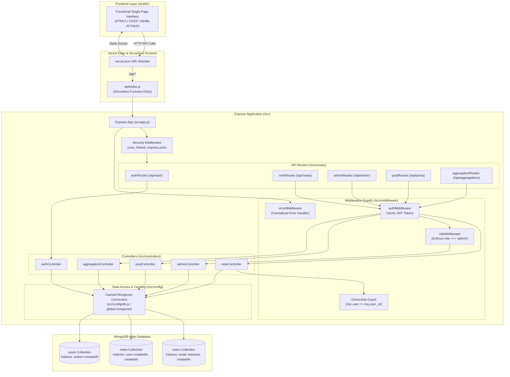
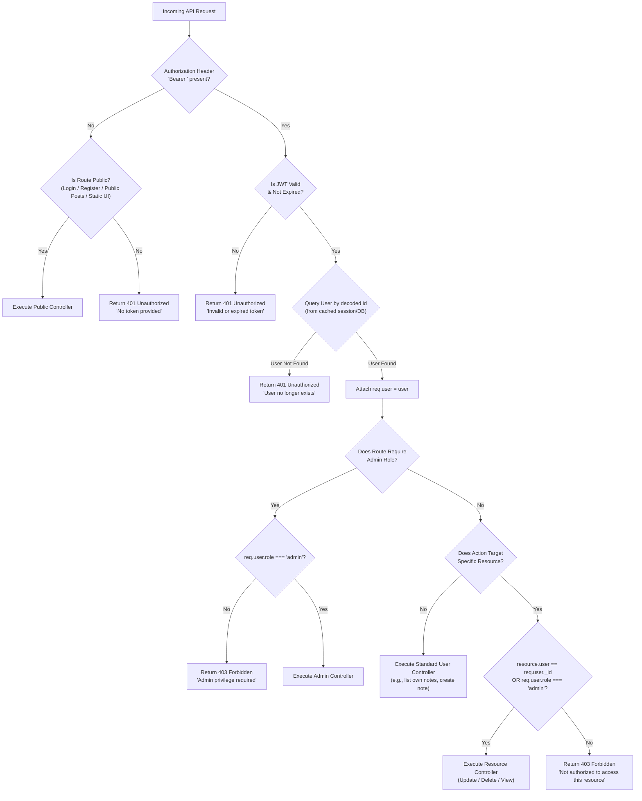
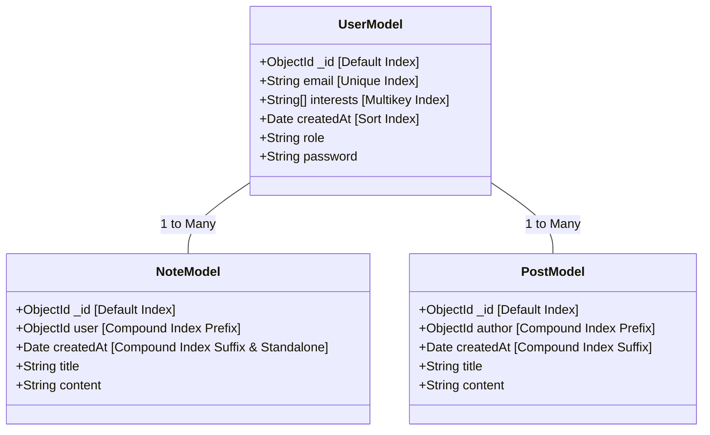
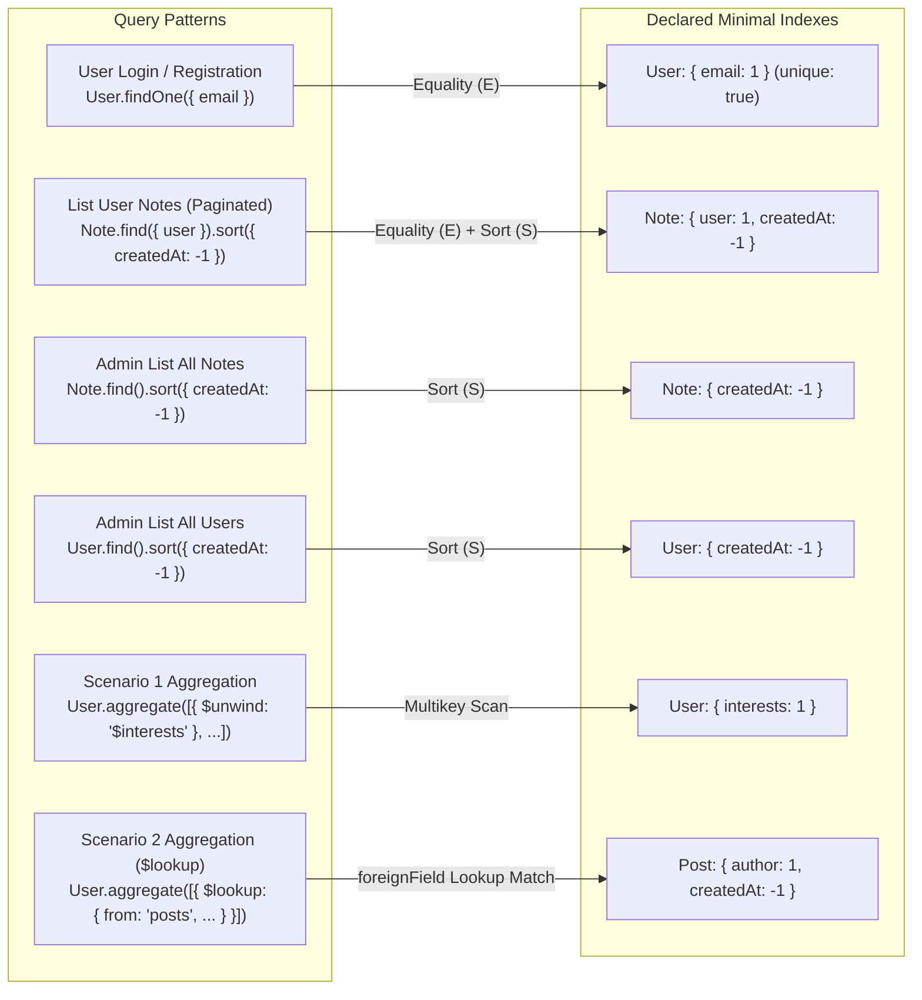
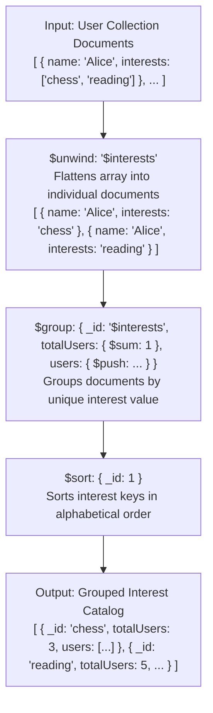
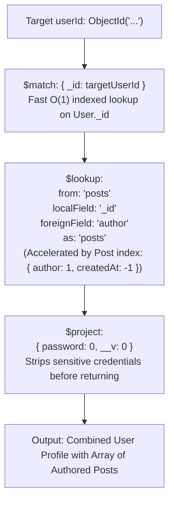
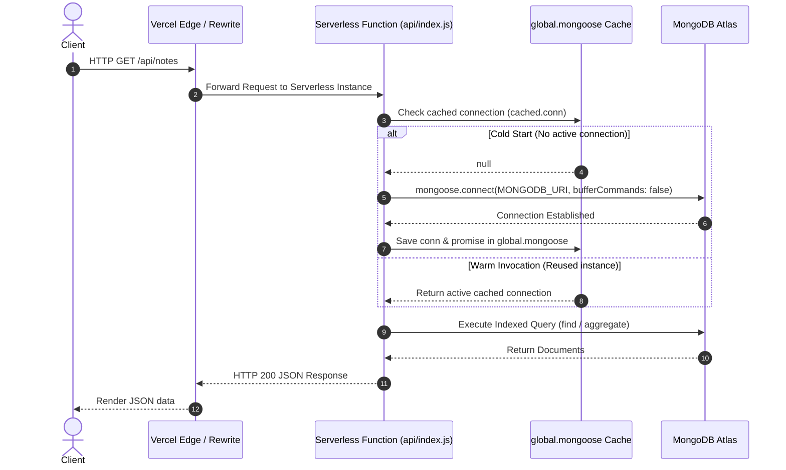
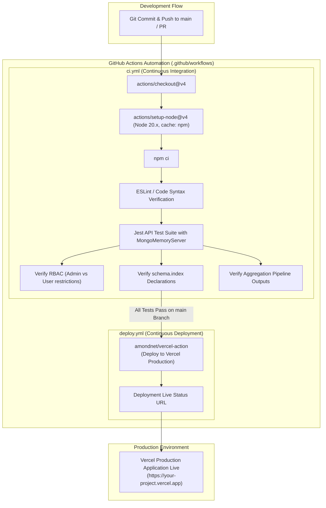

# Code Review & Architecture Graph

This document provides a comprehensive structural, security, database indexing, and CI/CD code review graph for the **Secure Note-Taking Application**. It serves as an evaluator's guide to verify architecture decisions, role-based access control, indexing efficiency, and pipeline logic.

---

## 1. System Architecture & Component Interaction Graph

---

## 2. Authentication & RBAC Verification Decision Graph

---

## 3. Database Indexing & Query Optimization Graph (ESR Compliance)

> **Interview Evaluation Requirement**: Only strictly necessary indexes; zero redundancy; explicit `schema.index()` declaration.

### Index Evaluation Matrix & ESR Justification

### Why No Redundant Indexes Exist
1. **No `{ user: 1 }` on `Note`**: Any query filtering strictly by `{ user: userId }` utilizes the left prefix of `{ user: 1, createdAt: -1 }`. Creating `{ user: 1 }` would be redundant.
2. **No `{ author: 1 }` on `Post`**: The compound index `{ author: 1, createdAt: -1 }` covers all equality lookups on `author` during `$lookup`.
3. **No separate index for `_id`**: MongoDB automatically manages a unique B-tree index on `_id` across all collections.

---

## 4. Aggregation Pipelines Execution Graph

### Scenario 1: Group by Interests Pipeline

### Scenario 2: User Posts `$lookup` Pipeline

---

## 5. Serverless Lifecycle & Database Connection Cache Graph

---

## 6. CI/CD Code Review & Automated Deployment Pipeline

---

## 7. Reviewer Verification Checklist

| Review Dimension | Expected Code Quality | Verification Method |
| :--- | :--- | :--- |
| **Index Visibility** | Uses `schema.index()` explicitly for all indexes. | Inspect `src/models/*.js`. Automated in test suite. |
| **Index Minimalism** | Zero duplicate/redundant prefix indexes. | Audit against ESR matrix in Section 3. |
| **RBAC Security** | Strict separation: standard user cannot view other users' notes or hit admin routes. | Execute `test/rbac.test.js`. |
| **Aggregation Constraints** | Exactly one `.aggregate()` call for Scenario 1; Single `$lookup` pipeline for Scenario 2. | Inspect `src/controllers/aggregationController.js`. |
| **Serverless Hygiene** | DB connection cached in global scope; prevents Atlas connection leak. | Inspect `src/config/db.js`. |
| **Frontend Simplicity** | Vanilla HTML/CSS/JS without heavyweight boilerplate/frameworks. | Inspect `public/index.html` & `public/app.js`. |
| **CI/CD Readiness** | CI passes test suite before CD triggers Vercel deployment. | Inspect `.github/workflows/ci.yml` & `deploy.yml`. |
